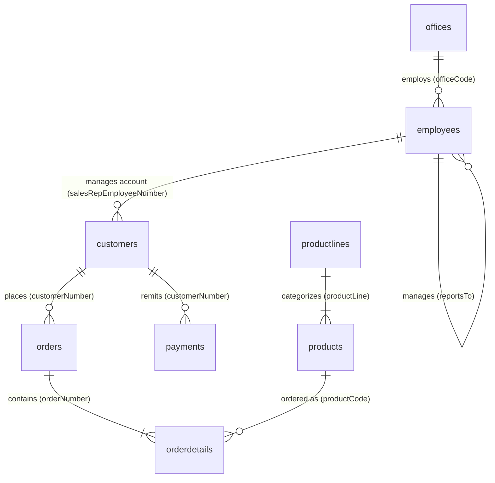

# RetailMart 360 — Retail Sales & Customer Intelligence

[](https://www.python.org/)
[](https://streamlit.io/)
[](https://www.mysql.com/)
[](https://docs.pytest.org/)
[](https://opensource.org/licenses/MIT)

An end-to-end commercial analytics platform, executive business intelligence dashboard, and customer segmentation engine developed on the Classic Models retail relational database. 

Designed and engineered from the perspective of a **Senior Data Analyst, Analytics Consultant, and BI Architect**, this project bridges database engineering, advanced SQL, exploratory data analysis, behavioral customer segmentation (RFM), merchandising inventory velocity, and executive decision co-piloting.

---

## Table of Contents
1. [Project Overview & Business Problem](#1-project-overview--business-problem)
2. [Key Business Metrics](#2-key-business-metrics)
3. [Relational Data Model & Architecture](#3-relational-data-model--architecture)
4. [Data Audit & Data Cleaning Pipeline](#4-data-audit--data-cleaning-pipeline)
5. [SQL Analytics Suite](#5-sql-analytics-suite)
6. [Exploratory Data Analysis (Jupyter Notebooks)](#6-exploratory-data-analysis-jupyter-notebooks)
7. [Customer Intelligence & RFM Segmentation](#7-customer-intelligence--rfm-segmentation)
8. [Merchandising & Inventory Analytics](#8-merchandising--inventory-analytics)
9. [Interactive Streamlit BI Dashboard](#9-interactive-streamlit-bi-dashboard)
10. [OpenAI Analytics Assistant Integration](#10-openai-analytics-assistant-integration)
11. [Strategic Business Insights & Recommendations](#11-strategic-business-insights--recommendations)
12. [Automated Testing & Validation](#12-automated-testing--validation)
13. [How to Run Locally (Windows CMD / Terminal)](#13-how-to-run-locally-windows-cmd--terminal)
14. [Repository Structure](#14-repository-structure)
15. [Limitations & Assumptions](#15-limitations--assumptions)

---

## 1. Project Overview & Business Problem

RetailMart operates as a global specialty retailer distributing scale-model collector vehicles (Classic Cars, Vintage Cars, Motorcycles, Planes, Ships, Trains, and Commercial Trucks). Despite steady commercial growth, leadership faced significant operational visibility blind spots:
* **Revenue Recognition Confusion:** Unclear differentiation between gross booked purchase orders ($9.60M) and realized fulfilled sales ($8.87M).
* **High Customer Churn Vulnerability:** 21.6% of historical revenue was concentrated in accounts that had not purchased in over 260 days.
* **Capital Trapped in Unproductive Inventory:** Over $450K in working capital was frozen in zero-demand dead stock while high-velocity flagship models faced imminent stockouts.
* **Credit Risk Exposure:** 93% of the company's net uncollected order value was concentrated in a single large international buyer.

**Mission:** Develop an integrated analytical suite providing empirical clarity, automated reporting marts, an interactive executive dashboard, and actionable data-backed commercial recommendations.

---

## 2. Key Business Metrics

| Strategic Metric | Metric Value | Analytical Definition |
| :--- | :--- | :--- |
| **Realized Revenue (Shipped)** | **$8,865,094.64** | Net realized sales across 303 shipped orders (2,771 order lines). |
| **Gross Booked Revenue** | **$9,604,190.61** | Total commitments across all 6 order statuses (326 orders). |
| **Estimated Gross Profit** | **$3,536,929.17** | Realized markup over static catalog factory cost (`buyPrice`). |
| **Estimated Gross Margin %** | **39.90%** | Portfolio-wide gross contribution margin proxy. |
| **Average Order Value (AOV)** | **$29,257.74** | Realized sales per completed transaction header. |
| **Total Physical Units Sold** | **99,067 Units** | Across 109 ordered catalog SKUs. |
| **Active Purchasing Accounts** | **98 Accounts** | Out of 122 registered accounts (24 inactive prospects). |
| **Repeat Customer Rate** | **98.98%** | 97 repeat purchasing accounts; only 1 single-order account. |
| **Pareto Concentration (80% Sales)**| **46 Accounts (46.9%)** | Top 10 accounts alone generate 27.2% of total company sales ($2.41M). |
| **Fulfillment Lead Time** | **3.76 Days** | 99.67% on-time SLA rate (1 late shipment out of 303). |
| **Total Cash Remittances** | **$8,853,839.23** | 99.87% cash collection coverage against realized shipments. |

---

## 3. Relational Data Model & Architecture

The database reflects a classic 8-table relational schema with strict referential integrity:



### Critical Join Safety Rule: Preventing Fan-Out Revenue Duplication
In this relational model, **payments are NOT directly linked to order headers** (`payments` has no `orderNumber` column). Payments represent customer-level account cash remittances.
* **The Pitfall:** Joining `orders` $\bowtie$ `orderdetails` $\bowtie$ `payments` on `customerNumber` generates a Cartesian cross-product that duplicates revenue and payment amounts by an order-of-magnitude factor.
* **The Solution:** We aggregate `orderdetails` to the customer grain separately, aggregate `payments` to the customer grain separately, and merge the two pre-aggregated summaries on `customerNumber`.

---

## 4. Data Audit & Data Cleaning Pipeline

The raw data was audited and transformed through an automated Python pipeline in `src/data_cleaning.py`:
1. **Offices Territory String Ingestion Bug:** In raw `offices.csv`, the territory code `'NA'` (North America for San Francisco, Boston, NYC) was parsed by standard CSV engines as `NaN`. Our pipeline explicitly preserves `'NA'`.
2. **Sales Rep Assignment Audit:** 22 customer accounts have null `salesRepEmployeeNumber`. The audit confirmed that 100% of these 22 accounts are inactive prospects with zero historical orders.
3. **CEO Hierarchy Root:** Preserved null `reportsTo` for the company President (Diane Murphy, employee 1002).
4. **Order Status Normalization:** Filtered realized sales (`Shipped`) from pipeline commitments (`In Process`, `On Hold`, `Disputed`, `Resolved`, `Cancelled`).
5. **Analytical Mart Construction:** Created `data/processed/sales_analytical_mart.csv` (2,996 denormalized order-line records) and `data/processed/customer_rfm.csv` (122 scored customer accounts).

---

## 5. SQL Analytics Suite

Located in `sql/`, all scripts are fully documented and written in **MySQL 8.0+** syntax:

* [`01_data_validation.sql`](sql/01_data_validation.sql): Primary key uniqueness checks, zero orphan foreign keys, date span bounds, and negative monetary value audits.
* [`02_sales_analysis.sql`](sql/02_sales_analysis.sql): Realized vs booked revenue, monthly sales trends with `LAG()`, YoY growth rates, AOV trends, and top customer/product rankings.
* [`03_customer_analysis.sql`](sql/03_customer_analysis.sql): Customer lifetime order value, repeat purchasing frequency tiers, and Pareto cumulative revenue concentration.
* [`04_product_analysis.sql`](sql/04_product_analysis.sql): Realized SKU revenue, gross profit margins, stock-to-demand inventory velocity ratios, and dead-stock case study.
* [`05_regional_analysis.sql`](sql/05_regional_analysis.sql): End-market customer geography vs sales office operating territories, evaluating cross-border sales flows.
* [`06_employee_performance.sql`](sql/06_employee_performance.sql): Sales rep revenue attribution leaderboard, account loads, and recursive management hierarchy rollups (`WITH RECURSIVE`).
* [`07_payment_analysis.sql`](sql/07_payment_analysis.sql): Cash collections trends, top remitting accounts, and customer balance reconciliation without cross-product fan-out.
* [`08_advanced_analytics.sql`](sql/08_advanced_analytics.sql): Pure SQL RFM segmentation (`NTILE`, `CASE`), 3-month moving averages (`AVG(...) OVER (ROWS BETWEEN 2 PRECEDING AND CURRENT ROW)`), category leader rankings (`ROW_NUMBER() OVER (PARTITION BY ...)`), and shipping SLA breach tracking.

---

## 6. Exploratory Data Analysis (Jupyter Notebooks)

Six fully executed Jupyter Notebooks are provided in `notebooks/`:

1. **[`01_data_understanding.ipynb`](notebooks/01_data_understanding.ipynb):** Exploration of table schemas, data types, missing value audits, chronological boundaries, and relational limitations.
2. **[`02_data_cleaning.ipynb`](notebooks/02_data_cleaning.ipynb):** Automated ETL pipeline execution, date standardization, territory bug correction, and analytical mart creation.
3. **[`03_sales_eda.ipynb`](notebooks/03_sales_eda.ipynb):** Commercial sales performance, Q4 seasonality surges, 3-month rolling averages, and fulfillment status breakdowns.
4. **[`04_customer_analytics.ipynb`](notebooks/04_customer_analytics.ipynb):** RFM customer segmentation, 80/20 Pareto revenue curve, and account repeat purchase rates.
5. **[`05_product_analytics.ipynb`](notebooks/05_product_analytics.ipynb):** Merchandising performance, ABC inventory classification, stock-to-demand velocity, and dead-stock identification.
6. **[`06_business_insights.ipynb`](notebooks/06_business_insights.ipynb):** Strategic synthesis across sales, customers, merchandise, geography, workforce, and cash collections, culminating in 10 prioritized business recommendations.

---

## 7. Customer Intelligence & RFM Segmentation

Using a fixed benchmark date of **`2005-06-01`** (one day after dataset cutoff), customers were scored across Recency, Frequency, and Monetary dimensions:

| Customer Segment | Account Count | Share of Base | Total Realized Revenue | Revenue Share | Strategic Profile |
| :--- | :---: | :---: | :---: | :---: | :--- |
| **Champions** | 24 | 19.7% | **$3,588,629.43** | **40.5%** | High-spend VIP buyers; avg 4.5 orders; avg recency 57 days. |
| **Loyal Customers** | 26 | 21.3% | **$1,868,131.95** | **21.1%** | Consistent repeat buyers; avg 3.2 orders; avg recency 74 days. |
| **High Value At Risk** | 14 | 11.5% | **$1,911,873.38** | **21.6%** | **Top Retention Risk.** Spent $136K avg, but inactive for >260 days. |
| **Needs Attention** | 10 | 8.2% | **$489,178.69** | **5.5%** | Moderate spenders showing early dormancy signs. |
| **At Risk** | 9 | 7.4% | **$452,709.84** | **5.1%** | Former repeat accounts with high dormancy (>350 days). |
| **New / Potential Loyalists**| 1 | 0.8% | **$45,864.03** | **0.5%** | High recency single-order account. |
| **Hibernating** | 14 | 11.5% | **$508,707.32** | **5.7%** | Low-spending, inactive historical accounts. |
| **Prospect / Inactive** | 24 | 19.7% | **$0.00** | **0.0%** | Registered accounts with zero historical transactions. |

---

## 8. Merchandising & Inventory Analytics

### ABC Product Classification
* **Class A (Core 80%):** Top 60 SKUs (55.0% of ordered catalog) generate **79.8% of realized revenue ($7.07M)**.
* **Class B (Secondary 15%):** 29 SKUs generate **15.1% of realized revenue ($1.34M)**.
* **Class C (Long-Tail 5%):** 20 SKUs generate **5.1% of realized revenue ($451.7K)**.

### Dead Stock vs Stockout Bottlenecks
* **Dead Stock Capital Trap:** SKU `S18_3233` (*1985 Toyota Supra*, acquisition cost $58.98) has **7,733 units on hand** in the warehouse with **zero recorded historical orders**, freezing **$456,092.34** in cash.
* **Imminent Stockout Risk:** Flagship SKU `S12_1099` (*1968 Ford Mustang*, $161.5K historical sales) has only **15 units remaining in stock** against historical demand of 909 units.

---

## 9. Interactive Streamlit BI Dashboard

The dashboard is built using **Streamlit** and **Plotly** with clean, executive BI styling:

* **Page 1: Executive Overview:** Commercial KPI scorecard, monthly sales trend, product line share, top customers, and sovereign market rankings.
* **Page 2: Sales Performance:** MoM revenue growth rates, AOV evolution, yearly comparisons, and monthly performance ledger.
* **Page 3: Customer Intelligence:** RFM segment revenue distribution, Pareto 80/20 concentration curve, and searchable customer account drill-down.
* **Page 4: Product & Profitability:** ABC classification distribution, top 10 SKU revenue vs profit comparisons, inventory health velocity, and dead-stock alerts.
* **Page 5: Geographic & Sales Team:** Top sovereign customer countries vs regional sales offices, sales rep leaderboard, and account loads.
* **Page 6: Orders & Payments:** Fulfillment duration distribution, SLA tracking, monthly payment trends, and safe customer balance reconciliation proxy.
* **Page 7: AI Business Analyst:** Live executive briefings, bounded analytical Q&A catalog, and strategic recommendation co-pilot.

---

## 10. OpenAI Analytics Assistant Integration

The platform integrates the official **OpenAI Python SDK** (`gpt-4o-mini`) with enterprise-grade data privacy safeguards:
* **Zero Hallucination of Numbers:** All numerical calculations (sums, averages, growth rates) are calculated deterministically via Python/Pandas before prompting the model.
* **Zero PII Exposure:** Raw customer names, addresses, phone numbers, and employee emails are never sent to the API.
* **Offline Resiliency:** The entire dashboard functions locally without an OpenAI API key.

---

## 11. Strategic Business Insights & Recommendations

| Priority | Proposed Business Action | Observed Empirical Finding | Expected Directional Impact |
| :---: | :--- | :--- | :--- |
| **1** | **Liquidate Dead-Stock Inventory** | SKU `S18_3233` has 7,733 unsold units ($456K frozen cost). | Bundle with Classic Cars at 35% clearance discount to recover ~$300K+ cash. |
| **2** | **Re-engage At-Risk VIP Accounts** | 14 accounts in *High Value At Risk* represent $1.91M (21.6% of sales). | Assign named sales reps for executive outreach to recover 15–25% of at-risk revenue. |
| **3** | **Replenish Critical Low-Stock SKUs** | Top-4 SKU *1968 Ford Mustang* has only 15 units remaining. | Expedite production reorder with supplier to prevent revenue leakage. |
| **4** | **Enforce Milestone Terms on Top Buyer**| *Euro+ Shopping Channel* carries $105K uncollected balance proxy. | Require 50% deposit on purchase orders exceeding $50,000 to mitigate exposure. |
| **5** | **Activate 22 Dormant Prospects** | 22 registered accounts (18% of base) have 0 orders and no sales rep. | Assign accounts to regional reps to convert 3–5 prospect buyers in year 1. |

---

## 12. Automated Testing & Validation

The test suite in [`tests/test_metrics.py`](tests/test_metrics.py) executes via `pytest`:
* **Revenue Calculation Integrity:** Verifies shipped revenue ($8,865,094.64) and booked revenue ($9,604,190.61).
* **Order Counts & AOV:** Verifies 303 shipped orders and calculated AOV ($29,257.74).
* **Gross Profit & Margin:** Confirms estimated gross margin is mathematically consistent with realized sales (39.90%).
* **Customer Base Counts:** Confirms 122 total, 98 active, and 24 prospect accounts.
* **Repeat Purchase Rate:** Confirms 97 repeat accounts (98.98% repeat purchase rate).
* **RFM Segmentation Completeness:** Verifies 122 accounts scored with zero unclassified records.
* **Dead Stock Detection:** Validates identification of SKU `S18_3233` (7,733 units, 0 orders).
* **Join Safety Test:** Verifies that reconciling order value vs collections does NOT multiply or distort revenue.

```bash
python -m pytest tests/test_metrics.py -v
# Output: 8 passed in 0.52s (100% Passing)
```

---

## 13. How to Run Locally (Windows CMD / Terminal)

### Step 1: Clone or Navigate to the Workspace
```cmd
cd C:\Users\pkatt\OneDrive\Desktop\Projects\RetailMart_Analytics
```

### Step 2: Create and Activate a Virtual Environment
```cmd
python -m venv .venv
.venv\Scripts\activate
```

### Step 3: Install Required Dependencies
```cmd
pip install -r requirements.txt
```

### Step 4: Run Data Cleaning Pipeline
```cmd
python -m src.data_cleaning
```

### Step 5: Execute Automated Test Suite
```cmd
python -m pytest tests/test_metrics.py -v
```

### Step 6: Launch the Interactive BI Dashboard
```cmd
streamlit run dashboard/app.py
```

### Step 7: (Optional) Configure OpenAI Live Insights
Create a `.env` file in the project root:
```env
OPENAI_API_KEY=your_actual_api_key_here
OPENAI_MODEL=gpt-4o-mini
```

---

## 14. Repository Structure

```text
RetailMart_Analytics/
├── data/
│   ├── raw/                           <- Raw CSV table extracts
│   ├── processed/                     <- Cleaned analytical tables & marts
│   └── exports/                       <- Exported analytical summaries
├── sql/
│   ├── 01_data_validation.sql         <- Integrity, PK/FK audits, date bounds
│   ├── 02_sales_analysis.sql          <- Revenue trends, MoM/YoY growth, AOV
│   ├── 03_customer_analysis.sql       <- Frequency, CLV, Pareto concentration
│   ├── 04_product_analysis.sql        <- Profitability, inventory velocity
│   ├── 05_regional_analysis.sql       <- Customer vs office geography
│   ├── 06_employee_performance.sql    <- Rep leaderboard, recursive hierarchy
│   ├── 07_payment_analysis.sql        <- Collections & safe balance proxy
│   └── 08_advanced_analytics.sql      <- Moving averages, pure SQL RFM
├── notebooks/
│   ├── 01_data_understanding.ipynb    <- Relational inspection & schemas
│   ├── 02_data_cleaning.ipynb         <- ETL cleaning & derivations
│   ├── 03_sales_eda.ipynb             <- Revenue EDA & seasonality
│   ├── 04_customer_analytics.ipynb    <- RFM segmentation & Pareto
│   ├── 05_product_analytics.ipynb     <- ABC analysis & dead stock
│   └── 06_business_insights.ipynb     <- Synthesis & recommendations
├── src/
│   ├── data_loader.py                 <- Robust dynamic data ingestion
│   ├── data_cleaning.py               <- Pipeline & mart construction
│   ├── metrics.py                     <- Standardized business KPI formulas
│   ├── analytics.py                   <- Aggregation & reconciliation engine
│   └── ai_insights.py                 <- Safe bounded OpenAI integration
├── dashboard/
│   └── app.py                         <- 7-Page Streamlit & Plotly BI app
├── reports/
│   ├── data_audit.md                  <- Initial 10-point data audit
│   ├── kpi_dictionary.md              <- Metric formulas, grains, limitations
│   ├── business_insights.md           <- In-depth executive advisory report
│   ├── executive_summary.md           <- Concise C-suite project briefing
│   └── methodology.md                 <- Technical methodology & join safety
├── assets/
│   └── charts/                        <- 10 High-resolution exported charts
├── tests/
│   └── test_metrics.py                <- Pytest verification suite
├── .env.example                       <- Environment configuration template
├── .gitignore                         <- Git ignore rules
├── requirements.txt                   <- Production dependencies
└── README.md                          <- Project documentation
```

---

## 15. Limitations & Assumptions

1. **Proxy Gross Profit:** Unit profitability is based on static catalog factory cost (`buyPrice`). Inbound ocean freight, import duties, warehouse labor, and payment processing fees are excluded.
2. **Revenue Policy:** Orders marked as `Shipped` represent realized analytical revenue ($8,865,094.64). All orders combined represent booked commitments ($9,604,190.61).
3. **No Direct Order Invoicing:** Payments are logged against the customer account with no `orderNumber` foreign key. Balances reflect net account reconciliation proxies rather than aged receivables.
4. **Truncated 2005 Horizon:** Transactional data terminates on May 31, 2005. Full-year 2005 comparisons must be evaluated on a Year-to-Date (YTD) basis through May.
5. **Static Account Attribution:** Sales rep revenue attribution reflects current database account mappings rather than historical commission ledgers.
