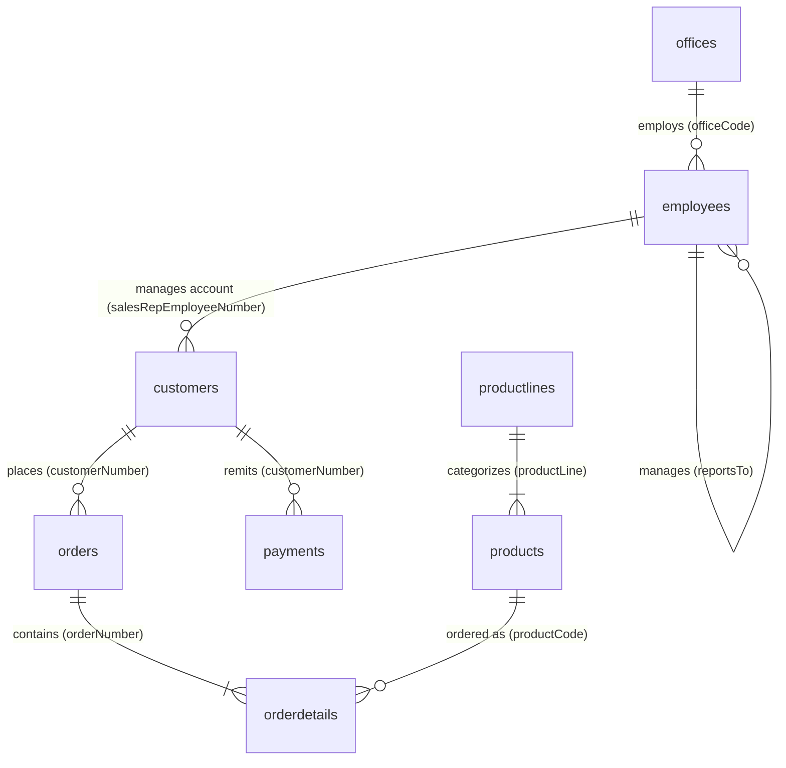

# RetailMart 360: Comprehensive Data Audit & Quality Report

**Prepared by:** Senior Data Analyst & Analytics Consultant  
**Project:** RetailMart 360 — Retail Sales & Customer Intelligence  
**Dataset Base:** Classic Models Relational Retail Database  
**Audit Date:** November 2026  
**Scope:** 8 Relational Tables (CSV Extracts & MySQL 8 Dumps)

---

## 1. Executive Summary

This data audit establishes the empirical foundation for the RetailMart 360 analytics platform. The dataset captures end-to-end commercial operations of a global scale-model vehicle retailer, encompassing customer profiles, employee reporting lines, regional offices, order transactions, line-item fulfillments, product catalog inventory, product lines, and payment collections.

Every table was audited across raw CSV files and MySQL dump scripts for schema parity, completeness, primary/foreign key integrity, value distributions, and edge-case anomalies. 

### Key High-Level Numbers
* **Total Customers:** 122 registered accounts across 28 countries (98 active purchasing customers, 24 inactive prospects).
* **Total Transactional Orders:** 326 distinct orders spanning January 6, 2003 through May 31, 2005.
* **Order Line Items:** 2,996 order detail rows across 109 ordered SKUs.
* **Total Gross Realized Revenue (Shipped):** $8,865,094.64.
* **Total Gross Booked Revenue (All Statuses):** $9,604,190.61 across 6 fulfillment statuses.
* **Total Payments Collected:** $8,853,839.23 across 273 payments.
* **Product Catalog:** 110 products across 7 product lines; 1 SKU (`S18_3233` - 1985 Toyota Supra) has never recorded an order.
* **Workforce:** 23 employees across 7 global offices spanning North America, EMEA, APAC, and Japan.

---

## 2. Dataset Inventory & Schema Definitions

| Table Name | Source File | Row Count | Column Count | Primary Key | Composite? | Foreign Keys | Parity with SQL Dumps |
| :--- | :--- | :--- | :--- | :--- | :--- | :--- | :--- |
| **`customers`** | `customers.csv` | 122 | 13 | `customerNumber` | No | `salesRepEmployeeNumber` $\rightarrow$ `employees(employeeNumber)` | 100% Match (122 rows) |
| **`employees`** | `employees.csv` | 23 | 8 | `employeeNumber` | No | `reportsTo` $\rightarrow$ `employees(employeeNumber)`, `officeCode` $\rightarrow$ `offices(officeCode)` | 100% Match (23 rows) |
| **`offices`** | `offices.csv` | 7 | 9 | `officeCode` | No | None (Root dimension) | 100% Match (7 rows) |
| **`orders`** | `orders.csv` | 326 | 7 | `orderNumber` | No | `customerNumber` $\rightarrow$ `customers(customerNumber)` | 100% Match (326 rows) |
| **`orderdetails`** | `orderdetails.csv` | 2,996 | 5 | (`orderNumber`, `productCode`) | Yes | `orderNumber` $\rightarrow$ `orders(orderNumber)`, `productCode` $\rightarrow$ `products(productCode)` | 100% Match (2,996 rows) |
| **`payments`** | `payments.csv` | 273 | 4 | (`customerNumber`, `checkNumber`) | Yes | `customerNumber` $\rightarrow$ `customers(customerNumber)` | 100% Match (273 rows) |
| **`productlines`**| `productlines.csv` | 7 | 4 | `productLine` | No | None (Root dimension) | 100% Match (7 rows) |
| **`products`** | `products.csv` | 110 | 9 | `productCode` | No | `productLine` $\rightarrow$ `productlines(productLine)` | 100% Match (110 rows) |

---

## 3. Detailed Column Definitions & Types

### 3.1. `customers`
* `customerNumber` (INT, PK): Unique numeric identifier (103 to 496).
* `customerName` (VARCHAR(50)): Commercial trading name of the retail business or hobbyist shop.
* `contactLastName` / `contactFirstName` (VARCHAR(50)): Primary buyer/purchasing contact.
* `phone` (VARCHAR(50)): International telephonic contact.
* `addressLine1` (VARCHAR(50)) / `addressLine2` (VARCHAR(50), Nullable): Physical location details.
* `city` (VARCHAR(50)): Billing/shipping municipality.
* `state` (VARCHAR(50), Nullable): Province or US State code.
* `postalCode` (VARCHAR(15), Nullable): Postal/ZIP code.
* `country` (VARCHAR(50)): Sovereign territory (28 unique countries).
* `salesRepEmployeeNumber` (INT, Nullable, FK): Designated internal sales account manager.
* `creditLimit` (DECIMAL(10,2)): Pre-approved commercial purchasing credit line ($0.00 to $227,600.00).

### 3.2. `employees`
* `employeeNumber` (INT, PK): Internal employee badge ID (1002 to 1702).
* `lastName` / `firstName` (VARCHAR(50)): Employee legal name.
* `extension` (VARCHAR(10)): Internal PBX phone extension.
* `email` (VARCHAR(100)): Corporate email address (`@classicmodelcars.com`).
* `officeCode` (VARCHAR(10), FK): Assigned physical branch location (1 to 7).
* `reportsTo` (INT, Nullable, FK): Self-referential reporting manager badge ID.
* `jobTitle` (VARCHAR(50)): Functional job designation (President, VP Sales, VP Marketing, Sales Manager, Sales Rep).

### 3.3. `offices`
* `officeCode` (VARCHAR(10), PK): Branch identifier ('1' to '7').
* `city` (VARCHAR(50)): Metropolitan hub (San Francisco, Boston, NYC, Paris, Tokyo, Sydney, London).
* `phone` (VARCHAR(50)): Direct trunk line.
* `addressLine1` / `addressLine2` (VARCHAR(50)): Street address.
* `state` (VARCHAR(50), Nullable): State or prefecture.
* `country` (VARCHAR(50)): Host country (USA, France, Japan, Australia, UK).
* `postalCode` (VARCHAR(15)): Official postal identifier.
* `territory` (VARCHAR(10)): Commercial operating theater (`NA`, `EMEA`, `APAC`, `Japan`).

### 3.4. `orders`
* `orderNumber` (INT, PK): Sequential transaction header (10100 to 10425).
* `orderDate` (DATE): Date transaction was placed (2003-01-06 to 2005-05-31).
* `requiredDate` (DATE): Promised delivery deadline agreed upon with customer.
* `shippedDate` (DATE, Nullable): Date goods departed distribution center.
* `status` (VARCHAR(15)): Fulfillment life-cycle state (`Shipped`, `Resolved`, `In Process`, `On Hold`, `Disputed`, `Cancelled`).
* `comments` (TEXT, Nullable): Special instructions, fulfillment alerts, or dispute notes.
* `customerNumber` (INT, FK): Ordering customer account number.

### 3.5. `orderdetails`
* `orderNumber` (INT, Composite PK, FK): Header linkage to `orders`.
* `productCode` (VARCHAR(15), Composite PK, FK): Catalog SKU identifier.
* `quantityOrdered` (INT): Units requested in line item (6 to 97 units).
* `priceEach` (DECIMAL(10,2)): Realized unit transaction price ($26.55 to $214.30).
* `orderLineNumber` (SMALLINT): Position on invoice/packing slip (1 to 18).

### 3.6. `payments`
* `customerNumber` (INT, Composite PK, FK): Paying customer account.
* `checkNumber` (VARCHAR(50), Composite PK): Financial remittance voucher or check number.
* `paymentDate` (DATE): Settlement date recorded (2003-01-16 to 2005-06-09).
* `amount` (DECIMAL(10,2)): Value of cash remittance ($615.45 to $120,166.58).

### 3.7. `products`
* `productCode` (VARCHAR(15), PK): Catalog SKU code (e.g., `S10_1678`).
* `productName` (VARCHAR(70)): Marketing title (e.g., `1969 Harley Davidson Ultimate Chopper`).
* `productLine` (VARCHAR(50), FK): Line classification.
* `productScale` (VARCHAR(10)): Model ratio (1:10, 1:12, 1:18, 1:24, 1:32, 1:50, 1:72).
* `productVendor` (VARCHAR(50)): Original manufacturing partner (13 unique vendors).
* `productDescription` (TEXT): Detailed model specifications and historical provenance.
* `quantityInStock` (SMALLINT): Physical inventory units in warehouse (15 to 9,997 units).
* `buyPrice` (DECIMAL(10,2)): Unit acquisition cost ($15.91 to $103.42).
* `MSRP` (DECIMAL(10,2)): Manufacturer Suggested Retail Price ($33.19 to $214.30).

### 3.8. `productlines`
* `productLine` (VARCHAR(50), PK): Category identifier (7 total).
* `textDescription` (VARCHAR(4000)): Plain text category overview.
* `htmlDescription` (MEDIUMTEXT, Nullable): Unused HTML markup placeholder.
* `image` (MEDIUMBLOB, Nullable): Unused binary image placeholder.

---

## 4. Missing Value & Duplicate Summary

| Table | Column | Null Count | Null % | Nature of Missingness | Analytical Handling |
| :--- | :--- | :--- | :--- | :--- | :--- |
| `customers` | `addressLine2` | 100 | 81.97% | Legitimate absence of secondary address line. | Retain as null/empty string; do not impute. |
| `customers` | `state` | 73 | 59.84% | Legitimate structural absence for non-US accounts. | Retain as null; rely on `country` for international aggregation. |
| `customers` | `postalCode` | 7 | 5.74% | Data omission in non-US accounts. | Impute `'Unknown'` or leave blank in address displays. |
| `customers` | `salesRepEmployeeNumber` | 22 | 18.03% | Unassigned prospect accounts or direct accounts. | Categorize as `'Unassigned / Direct'` in sales attribution. |
| `employees` | `reportsTo` | 1 | 4.35% | Diane Murphy (President, 1002); root of hierarchy. | Legitimate hierarchy root; handle safely in recursive CTEs. |
| `offices` | `addressLine2` | 2 | 28.57% | Legitimate absence of suite/floor. | Retain as null. |
| `offices` | `state` | 3 | 42.86% | Legitimate absence for Paris, Tokyo, London. | Retain as null. |
| `offices` | `territory` | 3 | 42.86% | **Ingestion artifact**: CSV value `'NA'` interpreted as NaN. | **Fix**: Explicitly map to `'NA'` (North America). |
| `orders` | `shippedDate` | 14 | 4.29% | Legitimate: orders are In Process (6), Cancelled (4), On Hold (4). | Retain as null; filter for shipped orders in delivery metrics. |
| `orders` | `comments` | 246 | 75.46% | Legitimate: transactional comments only on exceptions. | Retain as null/empty text. |
| `productlines`| `htmlDescription`| 7 | 100.0% | Unpopulated schema field in sample database. | Ignore in analytics. |
| `productlines`| `image` | 7 | 100.0% | Unpopulated schema field in sample database. | Ignore in analytics. |

### Duplicate Summary
* **Full-Row Duplicates:** Exactly 0 duplicates across all 8 tables.
* **Primary Key Duplicates:** Exactly 0 duplicates across all 8 tables.
* **Integrity:** Every entity is uniquely indexed.

---

## 5. Date Ranges & Chronological Boundary Analysis

| Date Field | Earliest Record | Latest Record | Total Span | Observed Volume Trend |
| :--- | :--- | :--- | :--- | :--- |
| `orders.orderDate` | `2003-01-06` | `2005-05-31` | 877 calendar days (~2.4 yrs) | Full years: 2003, 2004; Partial year: Jan–May 2005. |
| `orders.requiredDate` | `2003-01-13` | `2005-06-11` | 881 calendar days | SLA requirements track orders closely. |
| `orders.shippedDate` | `2003-01-10` | `2005-05-20` | 862 calendar days | Corresponds strictly to fulfilled shipments. |
| `payments.paymentDate`| `2003-01-16` | `2005-06-09` | 876 calendar days | Remittances follow order fulfillment cadence. |

> [!WARNING] Incomplete Calendar Year 2005
> The dataset terminates abruptly on May 31, 2005 for orders and June 9, 2005 for payments. Consequently, annual aggregations for 2005 will appear substantially lower than 2004 if not normalized as Year-to-Date (YTD) comparisons (Jan–May 2004 vs Jan–May 2005). Seasonal conclusions must account for this cut-off.

---

## 6. Primary & Foreign Key Relationship Audit

### Relational Integrity Check Results:
1. **`customers.salesRepEmployeeNumber` -> `employees.employeeNumber`**:
   - 0 orphan keys.
   - 100 customer records have valid sales reps; 22 have null sales reps.
2. **`employees.officeCode` -> `offices.officeCode`**:
   - 0 orphan keys. All 23 employees belong to valid offices (1 through 7).
3. **`employees.reportsTo` -> `employees.employeeNumber`**:
   - 0 orphan keys. 22 employees report to an existing manager; 1 employee (President) has null manager.
4. **`orders.customerNumber` -> `customers.customerNumber`**:
   - 0 orphan keys. All 326 orders belong to valid customers.
5. **`orderdetails.orderNumber` -> `orders.orderNumber`**:
   - 0 orphan keys. All 2,996 detail rows map to valid orders.
6. **`orderdetails.productCode` -> `products.productCode`**:
   - 0 orphan keys. All 2,996 detail rows map to valid catalog products.
7. **`products.productLine` -> `productlines.productLine`**:
   - 0 orphan keys. All 110 products belong to the 7 defined product lines.
8. **`payments.customerNumber` -> `customers.customerNumber`**:
   - 0 orphan keys. All 273 payments map to valid customers.

---

## 7. Granularity Discrepancies & Join Safety Rules

A critical finding in retail data modeling is distinguishing between the **four distinct grains** present in this dataset:

1. **Order-Line Grain (`orderdetails`):** 2,996 rows.  
   $$\text{Line Revenue} = \text{quantityOrdered} \times \text{priceEach}$$
2. **Order Header Grain (`orders`):** 326 rows.  
   Order status, fulfillment timing, total order value.
3. **Customer Account Grain (`customers`):** 122 rows.  
   Account demographics, assigned sales rep, aggregate customer metrics.
4. **Remittance Grain (`payments`):** 273 rows.  
   Cash payments made via check against cumulative customer accounts.

> [!CAUTION] The "Fan-Out / Cart-Before-The-Horse" Join Pitfall
> In this relational model, **payments are NOT directly linked to order headers** (there is no `orderNumber` foreign key in `payments`). 
> **Never join `orders` or `orderdetails` directly to `payments` using `customerNumber` alone without aggregating first!**
> Doing so creates a Cartesian cross-product that duplicates revenue and payment amounts by an order-of-magnitude factor. 
> *Rule:* Aggregate order revenue to the customer level first, aggregate payments to the customer level separately, and join the two pre-aggregated summaries on `customerNumber`.

---

## 8. Data Quality Findings & Cleaning Directives

1. **Offices Territory String Ingestion Bug:**
   - In `offices.csv`, the territory code `"NA"` (North America for San Francisco, Boston, NYC) is parsed by pandas as `NaN` (float missing value).
   - *Cleaning Action:* Explicitly map `NaN` -> `'NA'` (North America).
2. **Unassigned Customer Sales Representatives:**
   - 22 customers (18.03%) have a null `salesRepEmployeeNumber`. None of these 22 accounts have ever placed an order!
   - *Insight:* All 98 purchasing customers are assigned to an active sales representative. The 22 unassigned customers are un-contacted inbound leads or dormant prospect records.
3. **Zero Credit Limits:**
   - 24 customers have a recorded `creditLimit` of $0.00.
   - *Cross-Reference:* These 24 customers include the 22 unassigned prospect accounts plus 2 customer accounts that require cash-in-advance / prepayment terms.
4. **Zero-Order Catalog Item:**
   - SKU `S18_3233` (*1985 Toyota Supra*, buy price $58.98, MSRP $107.57, 7,733 units in stock) has exactly 0 orders across the entire 2.4-year history.
   - *Analytical Opportunity:* Classic dead-stock inventory case study. At $58.98 acquisition cost, 7,733 units tie up **$456,092.34** in unliquidated warehouse capital!
5. **Shipping Timing Analysis:**
   - 312 out of 326 orders have recorded a `shippedDate`.
   - Average fulfillment duration for completed shipments: **3.76 calendar days**.
   - Only 1 order (`10165`) recorded a shipped date after the agreed `requiredDate` (0.33% late shipment rate).
   - 14 orders have a null `shippedDate`: 6 In Process, 4 On Hold, and 4 Cancelled. (2 cancelled orders were shipped before being cancelled).

---

## 9. Business Analysis Opportunities

1. **RFM Customer Segmentation:** Calculate Recency, Frequency, and Monetary metrics across the 98 active buyers using a benchmark snapshot date of `2005-06-01` (the first day after the last historical order).
2. **Pareto (80/20) Revenue Concentration:** Assess revenue share generated by top 20% of customers and top 20% of catalog SKUs.
3. **Gross Margin & Contribution Analysis:** Compare realized transaction prices (`priceEach`) against factory unit costs (`buyPrice`) and recommended list prices (`MSRP`) to evaluate discount leakage and product profitability.
4. **Inventory Health & ABC Classification:** Benchmark current warehouse inventory levels against 2.4-year historical sales velocity to isolate over-stocked capital and low-stock replenishment risks.
5. **Sales Representative & Office Benchmarking:** Quantify quota attainment, active account loads, and average deal sizes across the 15 commissioned sales reps and 7 regional sales offices.
6. **Cash Conversion & Payment Coverage:** Reconcile total realized customer order billing proxies against cumulative cash collections to identify accounts with high outstanding order-value exposure.

---

## 10. Limitations & Analytical Assumptions

1. **Proxy Gross Profit:** Unit profitability is estimated as:
   $$\text{Gross Profit} = \sum (\text{priceEach} - \text{buyPrice}) \times \text{quantityOrdered}$$
   This represents a gross contribution proxy because `buyPrice` is a static catalog snapshot that does not reflect historical cost variances, inbound freight, holding costs, or taxes.
2. **Revenue Recognition Policy:** In this project, **shipped orders** represent realized analytical revenue ($8,865,094.64). Including all order statuses yields booked revenue ($9,604,190.61). We establish clear dual-metric reporting to avoid conflation.
3. **No Direct Order-Level Invoicing:** Because payments are unlinked to individual order IDs, customer balances represent net account-level balance proxies rather than aged accounts receivable (A/R) invoices.
4. **Static Sales Rep Assignment:** Revenue attribution reflects current account assignments; historical reassignments or territory redistributions are not tracked in the source tables.
5. **Truncated 2005 Horizon:** All comparisons between 2005 and prior periods must specify whether the horizon is full-year or YTD through May.
